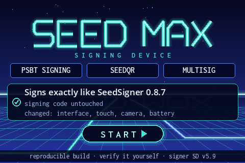
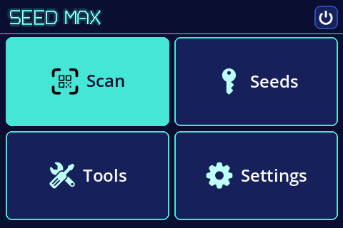
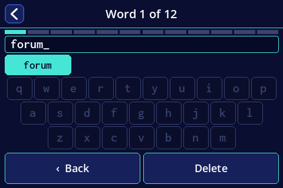
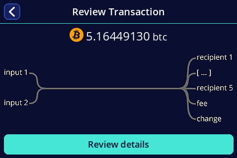
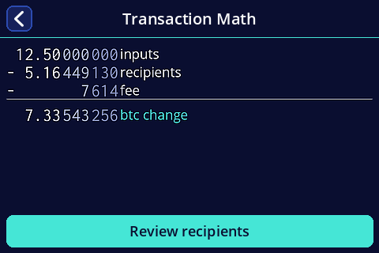
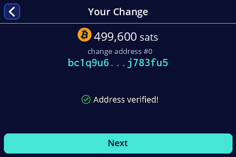
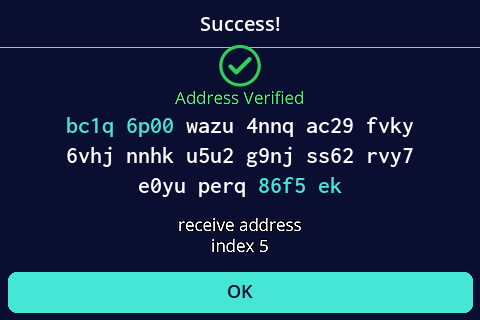
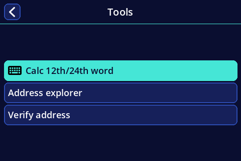
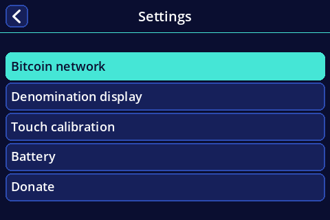

# Seed Max

**Firmware for a touchscreen, battery-powered air-gapped Bitcoin signer, based on [SeedSigner](https://github.com/SeedSigner/seedsigner) (MIT license). Part of [Perseo Lab](https://github.com/perseo-lab).**

> Seed Max is an independent project built on SeedSigner's code, which it keeps under its original MIT license and copyright. It is not affiliated with, endorsed by, or supported by the SeedSigner project. Please don't ask the SeedSigner team for help with it.

| Image | Branch | Latest | What it does |
|---|---|---|---|
| **Seed Max** | [`seed-max`](../../tree/seed-max) | v5.9 | SeedSigner 0.8.7 with a 3.5" resistive touch UI and a battery. Signs exactly like SeedSigner 0.8.7. |
| **Anti-Klepto Check** | **[perseo-lab/anti-klepto-check](https://github.com/perseo-lab/anti-klepto-check)** | v7.10 | A separate image that **never signs**. It verifies transactions signed by *another* device (Coldcard Q, SeedSigner, Trezor) against your seed. Now in its own repository; the [`anti-klepto-check`](../../tree/anti-klepto-check) branch here stays at v7.8 for history. |

---

## Screens

Generated from the code of this repository with SeedSigner's own screenshot generator, at the Max's 480×320 resolution: what you see is what the device draws.

| | | |
|---|---|---|
|  |  |  |
| Splash | Home | Seed words: only the letters that lead to a BIP-39 word |
|  |  |  |
| Review transaction | Transaction math | Change verified |
|  |  |  |
| Address verified, whole, in groups of four | Tools | Settings on one list |

```bash
# regenerate them (in a checkout with the test dependencies installed)
SEEDSIGNER_SCREENSHOT_RESOLUTION=480x320 python3 -m pytest tests/screenshot_generator/generator.py --locale en
```

---

## Hardware (v5)

The device is **[Raspy Max v5](https://github.com/perseo-lab/raspy-max-hardware)**: bill of materials, the 3D-printable case and a step-by-step build guide are in its own repository. No custom PCB, no soldering.

| Part | Notes |
|---|---|
| Raspberry Pi Zero **v1.3** | no Wi-Fi / Bluetooth on the board; hammer header |
| Waveshare 3.5inch RPi LCD **(A)** | 480×320 ILI9486 + XPT2046 resistive touch, plugged onto pins 1–26. Use a stylus. |
| Waveshare **UPS HAT (C)** | fixed-function chips only (no updatable MCU), physical ON/OFF switch; LiPo cell |
| Pi camera | under the display's overhang, flex cable folded once |

The v4 code paths (ST7796 4.0" panel, custom carrier PCB) are still in the tree but v5 is the tested build. All pins and panel parameters live in one auditable file: [`src/seedsigner/hardware/hw_profile.py`](../../blob/seed-max/src/seedsigner/hardware/hw_profile.py).

---

## What changes compared to SeedSigner 0.8.7

**The signing path is untouched.** Every file that reads the PSBT, checks change, derives keys or signs is byte-identical to SeedSigner 0.8.7 (commit `e0a80d4b`): `src/main.py`, the whole of `helpers/`, every file of `models/` except the two settings files, `views/psbt_views.py`, `seed_views.py`, `scan_views.py`, `tools_views.py`, `views/__init__.py` and `requirements.txt`. The test `tests/test_seedmax_identity.py` pins all of them by git blob id except `src/main.py`, which the `git diff` below covers. Check it yourself (no output = identical):

```bash
S=src/seedsigner
git diff e0a80d4b v5.9 --stat -- src/main.py requirements.txt $S/helpers \
  $(git ls-tree -r --name-only e0a80d4b $S/models | grep -v -E 'settings(_definition)?\.py$') \
  $S/views/__init__.py $S/views/psbt_views.py $S/views/seed_views.py \
  $S/views/scan_views.py $S/views/tools_views.py
```

The two settings files changed only to remove *Persistent Settings* and to fix some settings on the Max (see below): they store settings, they don't sign. In `psbt_screens.py` only colours, the hold-to-confirm on *Approve* and *Skip verification*, and the wording of the approve prompt ("Hold the button to approve this transaction") changed.

Everything else is interface, touch, camera, battery and menus:

- **Touch as the only input.** XPT2046 driver, debounce, calibrated hit-testing, drag to scroll. The joystick GPIO pins are no longer read (bare header pins next to GND could otherwise "press" Approve).
- **Hold to confirm** (1 s, progress bar) for approving a transaction, skipping change verification and exporting an xpub. It was attacked adversarially in real time: lifts, stalls, clock steps and finger drift all cancel it.
- **Input guard.** A touch that confirmed the previous screen, a resting finger, a double tap or a tap on a warning toast can't act on the next screen.
- **Battery gauge.** The INA219 on the UPS HAT is read **read-only** over bit-banged I2C. No register is ever written, and the OS has no I2C driver loaded.
- **QR display** 320×320 with on-screen brightness +/−, a density button (low / medium / high) for animated QR codes and an explicit *Done* button: a stray touch can't close a signed-PSBT QR.
- **Scanner zoom 1×/2×/3×** (camera ISP crop) for small address QR codes.
- **Seed words** are typed on a keyboard that lights only the letters still leading to a BIP-39 word, with up to four candidate words. After the last word they are reviewed all together, numbered as on the backup sheet and hidden until *Show*, with the BIP-39 checksum: *Confirm* only when it is right, tap a word to rewrite it. SeedSigner's own view still receives the words: only the screen is new.
- **Passphrase on three lines** of 40 characters, with spaces shown as dots: a passphrase that differs by one space is a different wallet.
- **Address verified** shows the whole address in groups of four, not a shortened one.
- **Tools:** Calc 12th/24th word, Address explorer, Verify address, BIP-85 child seed (SeedSigner's own BIP-85 code, the child's words on one screen). No *New seed* from the camera or from dice on the device: seeds are created off the device and loaded. *Load a seed* also offers Electrum seeds.
- **Settings on one list:** Bitcoin network, Denomination, Touch calibration, Battery, Donate. The security-relevant settings are fixed by the build and can't be changed by the menus or by a SettingsQR: no *Persistent Settings* (nothing is ever read from or written to the microSD), message signing off, privacy and dire warnings on, passphrase offered, script type and xpub format asked where they are used. Display preferences can still change: the language (for the session), QR density, scanner zoom and the QR screen's background.
- **Own look:** a "SEED MAX" splash with language chips (EN IT FR ES DE, for the current session only), a night-blue palette, an animated neon-grid screensaver. No SeedSigner logo and no sponsor logos: they belong to the SeedSigner project.

Tests: `tests/test_seedsigner_max*.py`, `tests/seedsigner_max_*.py`, `tests/test_seedmax_*.py` and `tests/seedmax_identity.py`, plus SeedSigner's own test suite. They include a real-time harness that drives the real screens with scripted touches.

---

## Anti-Klepto Check

Anti-Klepto Check, the air-gapped verifier that checks what your hardware wallet actually signed (RFC 6979 nonces against covert channels such as [Dark Skippy](https://darkskippy.com/), SIGHASH_ALL, change, txid), has moved to its own repository: **[perseo-lab/anti-klepto-check](https://github.com/perseo-lab/anti-klepto-check)**. It runs on the same hardware as Seed Max, [Raspy Max](https://github.com/perseo-lab/raspy-max-hardware), from its own microSD. Releases, documentation and issues are there.

---

## Status and honesty

- **Experimental software built by one person.** It is tested by the author on his own device: a mainnet signing test with Seed Max and Sparrow, and device tests of Anti-Klepto Check with a Coldcard Q and Sparrow. **No human third party has audited it.** Start with a test seed and small amounts.
- **Developed with AI assistance** (Anthropic's Claude). Commits carry `Co-Authored-By` lines. The "independent reviews" mentioned in commit messages were separate AI-agent reviews, adversarial tests and mutation testing, not human audits. Every finding is reproduced as a regression test.
- Seed Max's signing path is SeedSigner 0.8.7's, unchanged (see the `git diff` above), and the image's operating system is SeedSigner 0.8.7's, unchanged (see *Verify the image* below).

Bug reports are welcome as issues. Report security problems **privately** through [Security › Report a vulnerability](../../security/advisories/new), not in a public issue.

---

## Download and verify

Each [release](../../releases) has the `.img`, `SHA256SUMS` and `SHA256SUMS.asc`.

```bash
# 1. get my key (verify the fingerprint below from at least two places:
#    this README, my GitHub profile, keys.openpgp.org)
gpg --keyserver hkps://keys.openpgp.org --recv-keys 513B35830E4F869EFC6D9534F1A05CB16C898D92

# 2. verify the signature, then the files
gpg --verify SHA256SUMS.asc SHA256SUMS
sha256sum -c SHA256SUMS --ignore-missing
```

Flash the image to a microSD card with `dd` or GNOME Disks.

### Verify the image

A signature proves who published an image, not what is inside it. [`tools/ssmax_image_audit.py`](tools/ssmax_image_audit.py) proves what is inside: it compares a Seed Max image with the **official SeedSigner 0.8.7 image**, file by file, and shows that

- the disk layout, the boot partition, the kernel and every file of the operating system are the official ones;
- the only directory that differs is the application, `/opt/src`;
- with `--app-tree`, every file of `/opt/src` is exactly the file of the signed git tag, and every compiled `.pyc` really is the compilation of its `.py`.

It only reads the two image files: no root rights, nothing mounted, nothing installed, no network, Python 3 standard library only.

```bash
# 1. the official SeedSigner 0.8.7 pi0 image: download it from
#    https://github.com/SeedSigner/seedsigner/releases/tag/0.8.7
#    and verify it with SeedSigner's own instructions first
# 2. this repository at the release tag, with its signature checked
git clone https://github.com/perseo-lab/seed-max.git
git -C seed-max tag -v v5.9
# 3. the audit
python3 seed-max/tools/ssmax_image_audit.py seedsigner_os.0.8.7.pi0.img seed-max-v5.9-pi0.img \
    --app-tree seed-max --app-rev v5.9
echo "exit status: $?"
```

Exit status `0` means: operating system identical to SeedSigner 0.8.7, application identical to the tag. Without `--app-tree` the tool never exits with `0`: it exits with `4` (incomplete), because the application was not compared with any source. If the tag given with `--app-rev` doesn't exist, it stops with an error (`2`) instead of comparing whatever is checked out. The bytecode check recompiles the changed `.py` files, so it needs CPython 3.12 (any 3.12.x). With another Python the tool exits with `4` and says which checks it could not run; run it in `docker run --rm -v "$PWD":/w -w /w python:3.12 python3 seed-max/tools/ssmax_image_audit.py ...` instead.

What the audit does **not** verify: three subset fonts (NotoSans JP/KR/SC) are reported as different, because they are cut at build time by whatever fonttools version is installed, and the `egg-info` metadata. The fonts draw text, digits included, only when the language is Japanese, Korean or Chinese: the Max's own menus offer only EN IT FR ES DE, but a SettingsQR can still select those languages.

**Building from source.** The images are built with [SeedSigner OS](https://github.com/SeedSigner/seedsigner-os) (the 0.8.7 checkout), with this repository and the release tag as the app source:

```bash
SS_ARGS="--pi0 --app-repo=<this repository> --app-branch=v5.9" docker compose up --force-recreate --build
```

The build is deterministic in practice (fixed `SOURCE_DATE_EPOCH`, `mkfs.vfat --invariant`): two builds of the same tag give the same operating system and the same application files, which the audit above checks.

---

## Signing key

All commits and tags are signed.

```
Ollen_47
513B 3583 0E4F 869E FC6D 9534 F1A0 5CB1 6C89 8D92
```

---

## Support the project

Seed Max is free and open source. If it is useful to you, a donation is welcome, in two ways:

- **Lightning**, a **BOLT12 offer**: scan it with Phoenix, Zeus or another BOLT12 wallet.
- **On-chain**, a **Silent Payments address (BIP 352)**: every payment lands on a fresh Taproot output, so donations can't be linked or counted from outside. Send from a wallet that supports Silent Payments.

Both are in [`docs/DONATE.txt.asc`](docs/DONATE.txt.asc), **signed with the key above**, and the device shows the same two QR codes under *Settings › Donate*. Verify the signature before sending: a fork could replace this README, but it can't forge the signature. A BOLT12 offer has no checksum, so copy it from the signed file, never by hand.

```bash
gpg --verify docs/DONATE.txt.asc
```

---

## License and credits

MIT, like SeedSigner. Original code © 2021 SeedSigner contributors (see [`LICENSE.md`](LICENSE.md)). Seed Max and Anti-Klepto Check changes © 2026 Ollen_47, same license.

- [SeedSigner](https://github.com/SeedSigner/seedsigner): everything this is built on.
- XPT2046 read sequence after Paul Stoffregen's XPT2046_Touchscreen (MIT).
- ILI9486 init sequence after the Linux kernel's `drm/tiny/ili9486` driver.
